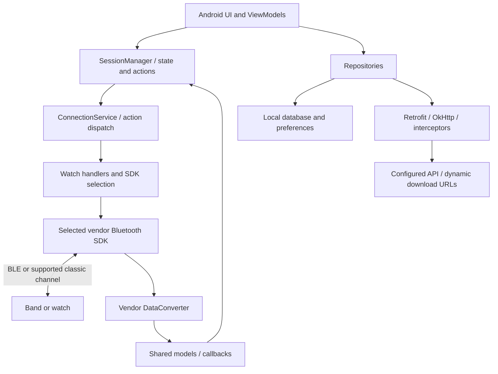

# Application architecture

## Android shell and application layers

The application starts at `com.noisefit.NoiseFitApplicationMain`. Its manifest includes onboarding/pairing and post-setup firmware activities, the main UI, background connection and notification services, call/SMS receivers, workers and content providers. AndroidX, Kotlin coroutines, LiveData, Hilt/Dagger, Retrofit/OkHttp, Gson and database code are present. Both view-based UI and Compose libraries are packaged. Flutter is embedded alongside the native Android app; `libapp.so`, `libflutter.so` and `assets/flutter_assets` establish this, but do not reveal every Dart feature.

Primary evidence: [AndroidManifest.xml](../analysis/AndroidManifest.xml), [SessionManager:1](../analysis/smali/classes18/com/noisefit/session/SessionManager.smali#L1), [NetworkModule:1](../analysis/smali/classes18/com/noisefit/di/NetworkModule.smali#L1).

This diagram summarizes source relationships; it is not a captured runtime trace.

## Main package boundaries

| Package / asset | Responsibility established from classes |
| --- | --- |
| `com.noisefit.ui` | Onboarding, dashboards, device management, firmware UI, watch faces, health and account screens |
| `com.noisefit.session` | Shared state and dispatch entry points for device queries, writes and activities |
| `com.noisefit.receiver.service` | Persistent device connection, notification handling, feedback and stocks |
| `com.noisefit.receiver.workManager` | Scheduled/background tasks including AGPS reminders |
| `com.noisefit.watch` | SDK selection and application/connection/query/update/activity handler facades |
| `com.noisefit.data` | API abstractions, repositories, response models, local storage and database code |
| `com.noisefit_commans` | Shared device models, actions, callbacks, capabilities, globals and storage contracts; spelling is from the APK |
| `com.noisefit_*`, `com.common_protocol`, `com.noisefit.hybrid`, `com.noisefit.noisefit_creek` | Device-family adapters and conversion code |
| `com.zhapp`, `com.zjw`, `com.ido`, `com.crrepa`, `com.touchgui`, `com.realsil`, `com.qcteam`, `com.topstep`, `com.ryeex`, `com.realthread` | Vendor SDK implementations and auxiliary protocols |
| `assets/python` | Python wearable RPC, files and OTA implementation |
| ARM64 split | Vendor protocol/media/crypto, Python, Flutter, speech, maps and ML native code |

## Important components

`ConnectionService` contains direct handling of `UpdateFirmware` and `VisionUpdateFirmware`, and uses selected update handlers. `ServiceUtil` dispatches many query, configuration and user-activity actions to the shared handler contracts. `SessionManager` provides the UI-facing action submission and observable callbacks. This separation explains why a screen does not directly write a GATT characteristic.

Sources: [ConnectionService:1824](../analysis/smali/classes18/com/noisefit/receiver/service/ConnectionService.smali#L1824), [ServiceUtil:1](../analysis/smali/classes5/com/noisefit/util/ServiceUtil.smali#L1), [UpdateDeviceHandler:1](../analysis/smali/classes5/com/noisefit/watch/UpdateDeviceHandler.smali#L1).

Notification and call flows have their own Android inputs: `NotificationAlertService` is registered with `android.service.notification.NotificationListenerService`, and `CallAndMessageReceiver` listens for phone/SMS events. Those phone events can become wearable messages through the chosen adapter. Requested permissions include contact/call/SMS access, Bluetooth scan/connect, location, notifications, foreground services and Health Connect writes; a manifest request does not prove permission was granted.

## Device identity and capabilities

The shared `ColorFitDevice` contains MAC address, device type, SDK type, protocol name, MCU platform, firmware ID, feature data, serial number, subscription type, sub-wearable type, matching/name metadata and binding/watch token fields. This is a richer identity than a Bluetooth advertised name. Use the selected record and capabilities to determine which features should execute.

Source: [ColorFitDevice:1](../analysis/smali/classes5/com/noisefit_commans/models/ColorFitDevice.smali#L1).

## Non-device features

The code also contains social/challenges, trophies, content, subscriptions, shopping/warranty, watch face generation, stock/weather, TVS integration, eSIM, voice/AI and health analysis features. They account for many APIs and dependencies. Their presence should not be treated as a capability of the small band. See the backend and action catalogs for the separate scopes.
