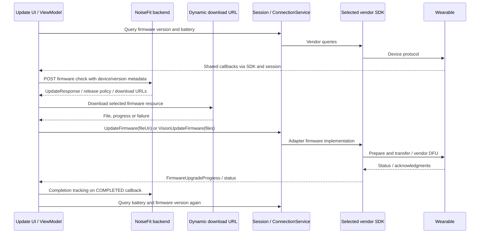

# Firmware update orchestration

## Entry points and overall sequence

The app includes manual device-management updates, post-pairing updates (`PostSetupFirmwareActivity`), home alerts and main-view-model download paths. This chapter traces the manual path through `CheckForUpdatesFragment` and `CheckForUpdatesViewModel`, whose source preserves the most explicit check/download/install lifecycle. Other entry points should not be assumed to have identical guards.

Sources: [CheckForUpdatesFragment:1](../analysis/smali/classes4/com/noisefit/ui/myDevice/manage/CheckForUpdatesFragment.smali#L1), [CheckForUpdatesViewModel:1](../analysis/smali/classes4/com/noisefit/ui/myDevice/manage/CheckForUpdatesViewModel.smali#L1), [PostSetupFirmwareActivity:1](../analysis/smali/classes4/com/noisefit/ui/onboarding/pairing/PostSetupFirmwareActivity.smali#L1), [MainViewModel:1](../analysis/smali/classes17/com/noisefit/MainViewModel.smali#L1).

The diagram describes intended code flow. No messages shown here were actually sent during research.

## Firmware check APIs

Configured base: `https://app-eks.gonoise.com`.

| Check | HTTP and path | Body fields constructed by the manual ViewModel |
| --- | --- | --- |
| Existing path | `POST /core/watch/firmware_versions` | `version`, `firmware_id`, `device_type`, `platform` = `android`, `mac`, `isOTARequired` |
| Recent path | `POST /firmware-versions/v3/recent` | `version_number`, `firmware_id`, `device_type`, `mac`, `build_number`, `platform` = `android` |

The two calls are exposed by distinct repository coroutine classes and different `NetworkService` methods. They are not just alternate strings for one demonstrated wire request. Null device fields and session state can affect the built object. Inspect the method for a concrete model before reproducing payloads.

Sources: [CheckForUpdatesViewModel:1618](../analysis/smali/classes4/com/noisefit/ui/myDevice/manage/CheckForUpdatesViewModel.smali#L1618), [CheckForUpdatesViewModel:1818](../analysis/smali/classes4/com/noisefit/ui/myDevice/manage/CheckForUpdatesViewModel.smali#L1818), [DeviceRepositoryImpl$checkForUpdates$2:1](../analysis/smali/classes18/com/noisefit/data/repository/implementation/DeviceRepositoryImpl$checkForUpdates$2.smali#L1), [DeviceRepositoryImpl$checkForUpdatesRecent$2:1](../analysis/smali/classes18/com/noisefit/data/repository/implementation/DeviceRepositoryImpl$checkForUpdatesRecent$2.smali#L1), [NetworkService:1805](../analysis/smali/classes18/com/noisefit/data/remote/abstraction/NetworkService.smali#L1805), [NetworkService:7992](../analysis/smali/classes18/com/noisefit/data/remote/abstraction/NetworkService.smali#L7992).

## Update response contract

`UpdateResponse` is wrapped in a generic API response. Gson annotations establish these JSON names:

| JSON field | Client representation / role |
| --- | --- |
| `description_chinese`, `description_english` | Optional release descriptions |
| `forceUpdate` | Mutable boolean update-policy flag |
| `softUpdate` | Boolean update-policy flag |
| `version` | Integer release/version identifier |
| `version_name` | Version name string |
| `url` | Optional primary download URL |
| `hr_url` | Optional HR component URL |
| `image_url` | Optional resource/image URL |
| `touch_url` | Optional touch/component URL |

The exact semantics of release IDs, rollout eligibility and server-side version comparison cannot be established from the DTO alone. There are no package hashes or signatures in this particular DTO; that does not exclude authentication/checking inside vendor packages or bootloaders.

Source: [UpdateResponse:1](../analysis/smali/classes18/com/noisefit/data/remote/response/UpdateResponse.smali#L1).

## Download and preconditions

In the normal manual update click path, the fragment permits a connected device or recognized DFU state; a navigation argument allows a special path around the ordinary connection check. For the common `p2()` download path, its constructor sets a battery threshold of 30 and the guard rejects battery **less than or equal to 30**, with missing battery treated as 0. The same navigation argument can bypass that battery check. This is one UI path, not a universal bootloader battery policy. The SDK_QUBE branch starts its vendor update directly with an empty URI and therefore follows a different workflow.

The fragment chooses a response URL according to SDK/device state, including `touch_url` on applicable branches, derives the filename from its last slash, and passes the URL, external cache directory and filename to `DownloadRepository`. `DownloadService` supports dynamic URL downloads; the configured `http://localhost/` is its Retrofit placeholder, **not evidence that firmware is hosted on the phone**. Firmware destinations are populated at runtime. A separate Vision path handles a list of typed component files.

Sources: [CheckForUpdatesFragment:71](../analysis/smali/classes4/com/noisefit/ui/myDevice/manage/CheckForUpdatesFragment.smali#L71), [CheckForUpdatesFragment:1579](../analysis/smali/classes4/com/noisefit/ui/myDevice/manage/CheckForUpdatesFragment.smali#L1579), [CheckForUpdatesFragment:3111](../analysis/smali/classes4/com/noisefit/ui/myDevice/manage/CheckForUpdatesFragment.smali#L3111), [CheckForUpdatesFragment:2162](../analysis/smali/classes4/com/noisefit/ui/myDevice/manage/CheckForUpdatesFragment.smali#L2162), [DownloadService:1](../analysis/smali/classes18/com/noisefit/data/remote/abstraction/DownloadService.smali#L1), [NetworkModule:586](../analysis/smali/classes18/com/noisefit/di/NetworkModule.smali#L586).

`Download$Progress`, `Download$Finished` and `Download$Failed` represent the download stage. The finished file becomes a local URI and is submitted as `UpdateDeviceAction.UpdateFirmware`; Vision uses `VisionUpdateFirmware`. Failure code records `ble.ota.download_failed` and installs a retry callback. This download progress is distinct from the vendor's transfer/install progress.

Sources: [CheckForUpdatesViewModel$downloadFirmware$1:1](../analysis/smali/classes4/com/noisefit/ui/myDevice/manage/CheckForUpdatesViewModel$downloadFirmware$1.smali#L1), [CheckForUpdatesViewModel$downloadFirmware$1$1:1](../analysis/smali/classes4/com/noisefit/ui/myDevice/manage/CheckForUpdatesViewModel$downloadFirmware$1$1.smali#L1), [CheckForUpdatesFragment:300](../analysis/smali/classes4/com/noisefit/ui/myDevice/manage/CheckForUpdatesFragment.smali#L300).

## Dispatch, progress and completion

`ConnectionService` recognizes `UpdateFirmware`, extracts its file URI and calls the selected `UpdateDeviceDataActions.P1(String)` implementation. That obfuscated method is the common handoff traced in chapter 06. Vendor listeners emit `UpdateDeviceDataCallback.FirmwareUpgradeProgress`, carrying `WatchUpdateStatus`. The manual UI handles progress/start-like states, completion and failure; state names come from `UpdateStatus` and the enum mapping class.

On the completion callback, the UI sends a tracking request, clears stored update state/alerts, records the last update time, deletes cached update material, and requests battery and firmware version again. **The tracking request is triggered by SDK completion before the later firmware-version query establishes the device's installed version.** An SDK success callback is not independent proof that the new firmware booted successfully.

Sources: [ConnectionService:1824](../analysis/smali/classes18/com/noisefit/receiver/service/ConnectionService.smali#L1824), [CheckForUpdatesFragment:715](../analysis/smali/classes4/com/noisefit/ui/myDevice/manage/CheckForUpdatesFragment.smali#L715).

## Completion reporting

`POST https://app-eks.gonoise.com/user_detail/user/firmware/tracking` receives a JSON body built with `fw_version`, populated from the selected response version name. The ViewModel rate-limits this call locally to one per two seconds; although its method accepts an integer too, the inspected body only adds `fw_version`.

Sources: [CheckForUpdatesViewModel:1289](../analysis/smali/classes4/com/noisefit/ui/myDevice/manage/CheckForUpdatesViewModel.smali#L1289), [DeviceRepositoryImpl$markOtaUpdateComplete$2:1](../analysis/smali/classes18/com/noisefit/data/repository/implementation/DeviceRepositoryImpl$markOtaUpdateComplete$2.smali#L1).

## What is still unknown

The available model is now identified as ColorFit Pulse 2; see [chapter 11](11-colorfit-pulse-2.md) for its TouchGUI path. No actual firmware response or payload was fetched. Consequently live download domains, current release versions, compatibility matrices, rollout rules, image signing keys, verified boot/anti-rollback enforcement and success after reboot remain unresolved. The app-side path is documented; a complete firmware/bootloader audit would need the actual image and device-specific protocol observation.
