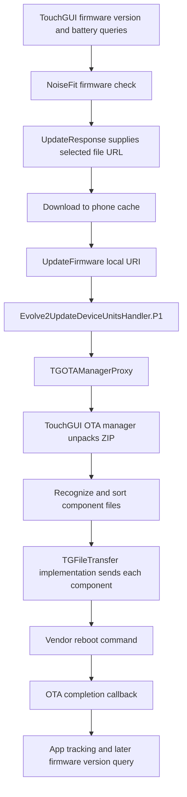

# ColorFit Pulse 2 — model-specific findings

## Identity and confidence

The user identifies the available device as **ColorFit Pulse 2**. The supplied APK has an exact model match:

| Property | Static evidence |
| --- | --- |
| Enum | `DeviceType.COLORFIT_PULSE_2` |
| Model name | `ColorFit Pulse 2` |
| Device key | `colorfit_pulse_2` |
| Integrated family indicated by model-specific code | `com.noisefit_evolve2`, backed by `com.touchgui.sdk` |
| Corresponding SDK selector | `EVOLVE` → `SDK_EVOLVE` |
| Default firmware ID used by explicit Pulse 2 branches | `2109` (`0x83d`) |

Sources: [DeviceType:1033](../analysis/smali/classes5/com/noisefit_commans/models/DeviceType.smali#L1033), [Evolve2QueryDeviceUnitsHandler$queryFirmwareVersion$1:114](../analysis/smali/classes5/com/noisefit_evolve2/handler/Evolve2QueryDeviceUnitsHandler$queryFirmwareVersion$1.smali#L114), [PairDeviceViewModel:2436](../analysis/smali/classes4/com/noisefit/ui/onboarding/pairing/pair/PairDeviceViewModel.smali#L2436), [WatchInfoGlobals:58](../analysis/smali/classes5/com/noisefit_commans/constants/WatchInfoGlobals.smali#L58), [WatchesSDK:858](../analysis/smali/classes5/com/noisefit/watch/WatchesSDK.smali#L858).

This static integration is now corroborated by user-supplied logs: they identify `colorfit_pulse_2`, record initialization of the Evolve SDK and log Evolve connection actions. See [device log findings](14-device-log-findings.md). No private selected-device record, service discovery or Bluetooth traffic capture was supplied. `WatchInfoGlobals.l()` reads a mutable field initialized to 2109; it is a firmware catalog identifier, **not** the installed firmware version, hardware revision or BLE opcode.

Other model keys are separate: Pulse 2 Max is `pulse_2_max`, Pulse 2 Buzz is `pulse_2_buzz`, and Pulse 2 Pro is `pulse2_pro`. Do not substitute those when following this device's backend or firmware path. The earlier Luna/ZH details concern different supported models.

## Model-specific version and pairing behavior

The TouchGUI firmware-version callback receives `TGVersionInfo`, checks for `COLORFIT_PULSE_2`, reads `WatchInfoGlobals.l()` and writes that value to the shared firmware-ID global through `x(int)`. It also processes the firmware version string, extracts a numeric suffix for the shared numeric version state, and stores the full version string.

The pairing ViewModel separately has a Pulse 2 branch that adds:

```text
version: <method input integer>
isOTARequired: true
firmware_id: <WatchInfoGlobals.l(), initially 2109>
device_type: colorfit_pulse_2
```

This is a reconstruction of that branch's object additions, not a captured response or a complete universal request schema. The ordinary update screen has its own request builders documented in chapter 05. A hardcoded catalog ID should not replace an observed runtime value if the app has changed it.

Sources: [Evolve2QueryDeviceUnitsHandler$queryFirmwareVersion$1:1](../analysis/smali/classes5/com/noisefit_evolve2/handler/Evolve2QueryDeviceUnitsHandler$queryFirmwareVersion$1.smali#L1), [PairDeviceViewModel:2272](../analysis/smali/classes4/com/noisefit/ui/onboarding/pairing/pair/PairDeviceViewModel.smali#L2272), [WatchInfoGlobals:258](../analysis/smali/classes5/com/noisefit_commans/constants/WatchInfoGlobals.smali#L258).

## Firmware path to prioritize



The general backend and UI guards still matter: firmware check endpoints on `app-eks.gonoise.com`, response-driven download URL, ordinary manual-path battery guard rejecting values at or below 30, connection/DFU checks, and completion tracking. Those are app-side behaviors, not proof of device-side enforcement.

### Adapter handoff

`Evolve2UpdateDeviceUnitsHandler.P1(String)` splits the local URI on `"///"`, takes the last segment, obtains `TGClient.w()` (`TGOTAManager`), installs a callback, then calls `a(filePath, false)`. This is the observed code rather than a general URI conversion contract.

The false argument matters: `TGOTAManagerProxy.a(String, boolean)` has an optional device-info-dependent branch for true; the app's inspected adapter passes false and enters its ordinary package-processing path. The proxy uses an atomic in-progress flag to reject an overlapping OTA and creates a `TGOTA<timestamp>` directory in the app's internal cache.

Sources: [Evolve2UpdateDeviceUnitsHandler:1377](../analysis/smali/classes5/com/noisefit_evolve2/handler/Evolve2UpdateDeviceUnitsHandler.smali#L1377), [TGOTAManagerProxy:26](../analysis/smali/classes5/com/touchgui/sdk/TGOTAManagerProxy.smali#L26).

### Package processing and component transfer

The underlying `com.touchgui.sdk.h` manager calls `internal.tb.a(packagePath, extractionPath)`, whose implementation uses `ZipInputStream`. It enumerates extracted top-level files, checks names against `internal.u3`, logs unknown files, sorts the selected list and starts file transfer. Optional component-selection filtering exists, but the inspected false branch passes no selection list. The transfer loop derives a file type from the filename and calls `com.touchgui.sdk.k.g(File, filename, type)` for each component. Progress combines earlier completed bytes and current-file bytes against an extracted-size total.

The SDK recognizes names including:

```text
a.bin, b.bin, apollo_boot.bin, st_boot.bin, boot.bin
res01.bin ... res05.bin, fonts.bin, Ftable.bin, Dfonts, Sfonts.bin
r_watch30.bin, r_watch40.bin, pkg.ota, update.bin
picture.watch, cfg_res.watch
lle_bds.lle, lle_glo.lle, lle_gps.lle, agps.bin, LTO2.bin, LTO7.bin
```

Additional regex matches include `copy_res.*` and `cfg_res.watch.*`. This is a **shared TouchGUI allowlist**, not a recovered Pulse 2 package manifest. It includes resources and GNSS data for other devices. It does not establish that Pulse 2 uses any particular boot image, MCU or assistance file.

Sources: [h:275](../analysis/smali/classes5/com/touchgui/sdk/h.smali#L275), [h:183](../analysis/smali/classes5/com/touchgui/sdk/h.smali#L183), [tb:1](../analysis/smali/classes5/com/touchgui/sdk/internal/tb.smali#L1), [u3:1](../analysis/smali/classes5/com/touchgui/sdk/internal/u3.smali#L1), [k:1](../analysis/smali/classes5/com/touchgui/sdk/k.smali#L1).

### Reboot and completion

After its transfer list is exhausted, the manager schedules a reboot operation. `h.k()` logs `reboot device` and invokes a vendor command through `internal.l9.f()`. Its `internal.q6` callback logs `OTA completed`, deletes the extraction directory, clears the in-progress flag and invokes `TGOTACallback.a()`. The Evolve2 callback maps this to shared `COMPLETED`, errors to `ERROR`, and progress to `PROGRESS`.

This is more precise than calling every progress event a firmware flash percentage: the code reports transfer progress and then vendor command completion. It does not independently confirm successful boot into the requested version. The later app firmware query remains relevant.

Sources: [h:515](../analysis/smali/classes5/com/touchgui/sdk/h.smali#L515), [q6:1](../analysis/smali/classes5/com/touchgui/sdk/internal/q6.smali#L1), [Evolve2UpdateDeviceUnitsHandler$updateFirmware$1:1](../analysis/smali/classes5/com/noisefit_evolve2/handler/Evolve2UpdateDeviceUnitsHandler$updateFirmware$1.smali#L1).

## Bluetooth evidence relevant to this family

TouchGUI's connection service code contains these service candidates:

```text
00000af0-0000-1000-8000-00805f9b34fb
000027f0-0000-1000-8000-00805f9b34fb
00002760-0000-1000-8000-00805f9b34fb
```

Its characteristic selection/notification handling also references `0af1`, `0af6`, `27f1`, `27f6`, `2761`, `2762` and `2763`, with the same Bluetooth base suffix. These are **TouchGUI SDK candidates**, not a measured Pulse 2 GATT table. The correct service/characteristic set, write properties and negotiated MTU require local discovery/capture from the actual unit. Do not use ZH `16186f..` UUIDs as this model's default.

Sources: [g:1](../analysis/smali/classes5/com/touchgui/sdk/internal/g.smali#L1), [l:1](../analysis/smali/classes5/com/touchgui/sdk/internal/l.smali#L1), [Evolve2ConnectHandler:1](../analysis/smali/classes5/com/noisefit_evolve2/handler/connect/Evolve2ConnectHandler.smali#L1).

## Configuration and data communication

Use the `Evolve2` column of the main coverage catalogs, or the [focused TouchGUI action catalog](catalogs/colorfit-pulse-2-touchgui-actions.md). It links shared actions to Evolve2 query/update/activity methods and their directly observed vendor calls. The catalog distinguishes a method with code from an empty/inherited implementation and does not promise physical-model support.

The relevant source families are:

- [Evolve2ConnectHandler:1](../analysis/smali/classes5/com/noisefit_evolve2/handler/connect/Evolve2ConnectHandler.smali#L1): connection and listeners through `TGClient`.
- [Evolve2QueryDeviceUnitsHandler:1](../analysis/smali/classes5/com/noisefit_evolve2/handler/Evolve2QueryDeviceUnitsHandler.smali#L1): queries and callback conversion.
- [Evolve2UpdateDeviceUnitsHandler:1](../analysis/smali/classes5/com/noisefit_evolve2/handler/Evolve2UpdateDeviceUnitsHandler.smali#L1): settings, notifications, watch faces and firmware.
- [Evolve2UserActivityHandler:1](../analysis/smali/classes5/com/noisefit_evolve2/handler/Evolve2UserActivityHandler.smali#L1): activity/history synchronization and related operations.

## Remaining model-specific unknowns

The user reports installed version `5.4.328.26`; an authorized check later returned matching version metadata and an `images.gonoise.com` URL, documented in [chapter 16](16-returned-pulse-2-firmware.md). The returned ZIP has now been recovered and contains one `a.bin` code component; see [chapter 17](17-recovered-firmware-analysis.md). Exact hardware revision, observed BLE table, full-image/base-version dependencies, device-side signature/anti-rollback policy and interruption recovery remain unknown. No device communication, firmware download or backend request was performed to fill those gaps. The identified default catalog ID and SDK allowlist are research evidence, not instructions to flash a guessed image.
