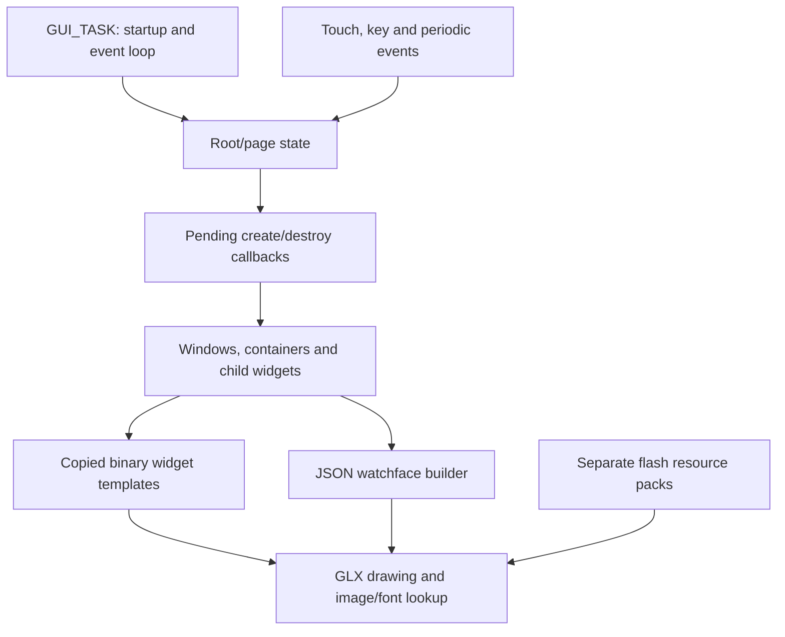

# GUI architecture, navigation and home-screen handling

## Screen execution is callback driven

The source paths embedded in assertions identify `elx_ui/touch_glx/visual_studio_2017_sdl/glx/…` and `gui_screen/…`. Together with `glx_image_loader_*` strings and the reviewed widget code, this identifies a **GLX UI framework in an ELX application tree**. A Windows/SDL source-tree path is a build-time diagnostic, not evidence that SDL or Visual Studio runs on the watch.



The diagram summarizes subsystem relationships. It is not a complete call graph or a verified event ordering trace.

## Startup

At `0x01079efc`, `GUI_TASK` logs `gui_task...`, resets GUI state, initializes resources through `0x01071e7c`, installs auxiliary callbacks, and chooses initial create/destroy handlers based on a mode getter. One startup pair is `0x01067538` / `0x010675b0`; another is `0x0109122c` / `0x01091298`. The mode's complete enumeration has not been recovered.

The startup helper `0x01076244` stores the initial destroy callback at root +4, stores the create pointer through RAM `0x00806b24`, and immediately branches through that create pointer. This startup path is distinct from the later screen-registration stubs. Do not label the initial screen as the normal home screen without following the mode and later transitions.

Source: [GUI startup](../../analysis/firmware/colorfit-pulse-2/deep-dive/evidence/gui-task.txt), [startup helper and event callback setters](../../analysis/firmware/colorfit-pulse-2/deep-dive/evidence/page-root-and-callbacks.txt).

## Page registration and transition state

Forty matching stubs implement this repeated pattern, shown as analyst pseudocode:

```c
// Example: runtime entry 0x010789e0; original C names unavailable.
request_pairing_screen() {
    root = get_root();                 // 0x01071b68 -> 0x008363e8
    if (root->byte_at_0x20 == 0) {
        root->callback_at_0x08 = 0x010913c1;  // destroy, Thumb pointer
        root->callback_at_0x0c = 0x010912cd;  // create, Thumb pointer
        root->byte_at_0x20 = 1;
        *(uint16_t *)0x00806abc = 1;
    }
}
```

These stubs install pending callback state; they do **not** directly execute both callbacks. The guard suppresses a new registration while the state byte is already set. A transition processor elsewhere consumes this state; its full ordering and cancellation behavior have not been reconstructed.

The distinct setters `0x01076260` and `0x0107626c` store callbacks at root +0x14 and +0x1c. Registration patterns and references to `view_tick_handler`, `view_key_handler` and `view_touch_handler` associate separate periodic/key/touch paths. Keep the precise semantic names provisional until all dispatchers are traced. The lower-level dispatch structure at `0x00836394` also invokes callbacks indirectly.

Source: [raw registry with pointers](../../analysis/firmware/colorfit-pulse-2/deep-dive/screen-registry.json), [registry extraction script](../../analysis/tools/firmware_screen_registry.py).

## Windows, widgets and layout templates

`0x01072e98` allocates a 64-byte window object and installs several framework callbacks. When its input flag equals 1, it additionally allocates a 28-byte state structure and writes dimensions **240 × 280** twice. This agrees with the full-size cached watchface image. It supports the logical rendering canvas dimensions; it is not a panel datasheet measurement.

`0x01072d80(window, template, length, callback)` frees an old template buffer if present, allocates `length` bytes, copies the supplied binary template, stores it at window +8, and stores the caller's callback at +0x2c. This is clear evidence that much of the screen layout is **compiled data plus widget code**. It is not Android XML and does not require a separate executable for each screen.

Repeated watchface/widget handling strides through **20-byte records**. Reviewed instructions access the widget type at record +2; code uses type `0x33` for text-like cleanup and `0x3a` as a terminating record. Other field meanings remain only partly decoded. Packed template coordinates and IDs are promising reconstruction inputs, but a complete struct declaration and all widget type semantics have not been verified.

Sources: [window constructor](../../analysis/firmware/colorfit-pulse-2/deep-dive/evidence/window-constructor.txt), [template copy](../../analysis/firmware/colorfit-pulse-2/deep-dive/evidence/template-copy.txt), [watchface/template builder](../../analysis/firmware/colorfit-pulse-2/deep-dive/evidence/watchface-build.txt).

## What is known about home and menu layouts

There is a concrete watchface construction path: it walks `HEAD`, reads `WATCH_NUM`, allocates a widget record buffer, walks `WATCH` with callback `0x01044600`, appends a type `0x3a` sentinel, and attaches the result to a window. [Chapter 05](05-watchface-format-and-rendering.md) reconstructs the supplied face's actual layout.

Several candidate surrounding views are recoverable, without enough evidence to call them a complete home/launcher mapping:

| View | Observed structure | Remaining uncertainty |
| --- | --- | --- |
| Screen 1 / create `0x010912cc` | Two child pages; one invokes QR builder `0x01092fd4` | Identified as pairing/QR flow, not normal home |
| Screen 13 / create `0x01088678` | Seven-page container, multiple child windows and templates, additional viewer state | Exact page labels and ordering are unresolved |
| Screen 37 / create `0x0104bfe4` | Five child views; templates at `0x010cc0e8` and nearby addresses; `menu_chose_index` state | Menu-like structure confirmed; exact launcher versus control-panel role unresolved |
| Screen 43 / create `0x01091454` | Two alternative layouts selected through a state getter; resource IDs including `0x242`–`0x245` | Exact feature name unresolved |

The five-page view copies buffers of lengths `0x3c`, `0x8c`, `0x8c`, `0x8c`, `0x50` into children and binds additional callbacks. Resource IDs alone cannot supply the original icons or user-visible labels. The seven-page count similarly does not prove seven home cards.

Sources: [pairing creation](../../analysis/firmware/colorfit-pulse-2/deep-dive/evidence/pairing-create.txt), [seven-page viewer](../../analysis/firmware/colorfit-pulse-2/deep-dive/evidence/seven-page-viewer.txt), [five-page menu](../../analysis/firmware/colorfit-pulse-2/deep-dive/evidence/five-page-menu.txt).

A complete “swipe left opens X, button opens Y, long press selects face Z” map requires tracing event constants and state-dependent callback targets, then preferably observing those transitions on the physical watch. This investigation has not established that map.
