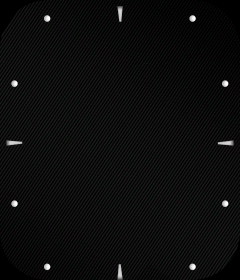

# Watchface container, layout and rendering code

## Actual recovered images

| Full-size clock background | Embedded preview |
| --- | --- |
|  |  |

These PNGs were decoded from uncompressed image entries in the supplied cached `watchface.zip`. Pixels decode coherently as **big-endian RGB565**; little-endian decoding produces visibly incorrect colors. The preview's blue surround, clock hands, date and weekday are already drawn into that image. It is not a screenshot captured from the watch.

The background has tick marks and a dark textured face, without hands or date/week text. This separation agrees with the JSON's dynamic pointer-clock and text components. It provides a concrete home/watchface appearance for this cached face, without establishing that it is the current face or one bundled in `a.bin`.

## Container structure recovered from the cache

Despite its filename, this file is **not a ZIP archive**. Its first seven little-endian 32-bit words form a compact header. Offset fields below use file byte **4** as their origin:

| Header field | Value | Result |
| --- | ---: | --- |
| Magic | `0x00ffaa22` | File bytes `22 aa ff 00` |
| JSON relative offset | 24 | Absolute offset 28 |
| JSON length | 844 | JSON text plus trailing zero |
| Image index relative offset | 868 | Absolute offset 872 |
| Image index length | 820 | 4-byte count + 51 × 16-byte records |
| Image data relative offset | 1688 | Absolute offset 1692 |
| Image data length | 577,048 | Ends exactly at file size 578,740 |

The index begins with little-endian count **51**. Each 16-byte record parses as:

```text
uint16 image_id
uint16 width
uint16 height
uint16 format_tag
uint32 unknown_value       // 51 in all records of this sample
uint32 relative_offset
```

This field naming is an analyst reconstruction from one sample. In particular, the meaning of the repeated value 51 is unresolved; it should not be treated as a universal constant.

At data offset 1692, two 32-bit values are `8` and `211688`, consistent with raw and encoded image bank positions. The observed address rules are:

```text
format 0: absolute_start = 1692 + record.relative_offset
format 1: absolute_start = 1692 + 211688 + record.relative_offset
```

| Image(s) | Dimensions | Format | Observed contents |
| --- | --- | ---: | --- |
| 0 | 240 × 280 | 0 | Raw RGB565 background, relative offset 8, length 134,400 |
| 1 | 184 × 210 | 0 | Raw RGB565 preview, relative offset 134,408, length 77,280 |
| 2–50 | 240 × 280 | 1 | Custom encoded records, retained individually for further decoding |

The raw bank ends at `8 + 134400 + 77280 = 211688`, exactly matching the second bank position. Encoded record offsets are monotonic and their ranges fit within the file. These independent length checks support the recovered container layout.

The encoded data has repeated dimension/ID fields and row-like tables. Its complete pixel/run codec has **not** been established, so this investigation does not claim to have reconstructed all clock-hand frames. The [extractor](../../analysis/tools/decode_cached_watchface.py) preserves each encoded entry rather than presenting an unverified decoder as working.

Source: [structure and all 51 records](../../analysis/firmware/colorfit-pulse-2/deep-dive/watchface/structure.json), [extracted JSON](../../analysis/firmware/colorfit-pulse-2/deep-dive/watchface/layout.json), [encoded entries and raw image alternatives](../../analysis/firmware/colorfit-pulse-2/deep-dive/watchface/).

## Exact layout of this cached face

| Component | Recovered configuration | Interpretation |
| --- | --- | --- |
| `image` | visible 1; x=0, y=0, id=50 | Uses image ID 50, an encoded entry. Do not silently substitute raw image 0 as an identical runtime background. |
| `text_date` | x=0, y=90, w=240, h=22; text_id=16; align=2; spacing=0; RGB=(250,100,75) | Full-width date rectangle near upper-middle; orange text |
| `text_week` | x=0, y=170, w=240, h=22; text_id=16; align=2; abbreviation=0; RGB=(153,153,153) | Full-width weekday rectangle below center; gray text |
| `image_pointer_clock` | hour start ID=34; minute start ID=2; second start ID=18 | Three pointer image selection sequences; exact frame progression remains unresolved |
| `PREVIEW.image` | id1=1, id2=1 | Preview refers to the decoded image 1 |
| Header counters | WATCH_NUM.num=10; PREVIEW_NUM.num=1 | Raw metadata counters; not ten executable watch apps |

The JSON contains four immediate WATCH component keys while `WATCH_NUM` equals 10. This mismatch warns against interpreting that counter as the literal number of JSON children; generated widget count or format-specific allocation accounting is plausible but not proven.

Numerical alignment value 2 is consistent with centered date/week text in the embedded preview; the full alignment enumeration is not decoded. Exact glyph shape and baseline require the firmware's font resources. The original preview shows `06/23` and `Friday`; live values would be generated by the firmware.

## Recovered firmware construction path

The code around `0x01086948` resets watchface state, obtains a resource pointer through `0x01070fd8`, then calls the JSON section walker twice:

```c
// Analyst pseudocode for the reviewed block; not original source.
reset_watchface_buffers();
walk_json_section(resource, "HEAD", callback_0x0104a420);
count = watchface_state.count;
records = allocate((count + 1) * 20);
clear(records);
records[count].type = 0x3a;       // sentinel
walk_json_section(resource, "WATCH", callback_0x01044600);
attach_template(window, records, (count + 1) * 20, NULL);
free(records);                   // attach_template has copied the buffer
```

`0x0106e2d2` copies a 24-byte resource header, parses JSON at resource +24, finds a requested top-level section by its string key, iterates its members, and calls the supplied callback for each child. It later deletes the parsed tree and frees a related allocation. This resource-pointer view is consistent with the cached file's outer offset origin: JSON at file +28 corresponds to +24 from a resource pointer at file +4. The entire pointer-selection chain has not been checked dynamically.

`0x0104a420` recognizes `WATCH_NUM` and reads `num` into watchface state. `0x01044600` is a large node parser/builder with comparisons for component names and subsequent property reads. Its `image_pointer_clock` branch reads `hour_id_start_time`, `min_id_start_time`, and `sec_id_start_time`, independently confirming the significance of the cached JSON keys.

Sources: [builder block](../../analysis/firmware/colorfit-pulse-2/deep-dive/evidence/watchface-build.txt), [JSON walker](../../analysis/firmware/colorfit-pulse-2/deep-dive/evidence/json-section-walk.txt), [HEAD parser](../../analysis/firmware/colorfit-pulse-2/deep-dive/evidence/watchface-head-parser.txt), [node parser](../../analysis/firmware/colorfit-pulse-2/deep-dive/evidence/watchface-node-parser.txt).

## Supported component families visible in code

The parser contains considerably more capability than this one face uses:

| Family | Representative compared keys |
| --- | --- |
| Digital time | `image_clock`, `multiple_image_clock`, `text_clock`, `text_12h_time`, `text_am_pm_time` |
| Analog time | `image_pointer_clock`; hour/minute/second start IDs |
| Calendar | `text_date`, `text_month_week`, `text_only_date`, `text_week`, `text_only_month`, `text_month_date`, `image_week`, `image_month`, `image_day` |
| Battery | `image_battery`, `text_battery`, `multiple_image_battery`, circular battery progress |
| Activity/measurements | `text_data`, `multiple_image_data`, `progress_step`, `progress_kcal`, `progress_heart`, circular progress forms |
| Weather | `weather_section`, `image_weather` |
| Animation | `image_animation`; properties including image ID/count/interval/width |
| Style/geometry | `visible`, text/font IDs, spacing, alignments, RGB channels, time digit positions, movement and zero-hiding options |

This is compiled parser capability, not a guarantee that every combination is supported by the physical device or accepted by the phone's watchface creator. A few automatically resolved string candidates include a preceding printable byte; the [102-entry candidate vocabulary](../../analysis/firmware/colorfit-pulse-2/deep-dive/watchface-parser-keys.json) is an evidence inventory, not a validated formal schema. The table above uses the clean, reviewed key families.

We have not yet reconstructed dynamic callback timing, the complete image codec, font ID mapping, maximum widget counts, arbitrary custom-face compatibility, or a faithful emulator. The recovered container, two decoded images and reviewed parser path are sufficient to establish that the face is resource-driven rather than a separate installed application.
