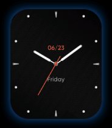

# ColorFit Pulse 2 firmware: OS, screens and watchfaces

This is an offline investigation of **V5.4.328.26**, recovered in `ColorFitPulse2V26diffa.zip`. It covers the watch firmware itself, separately from the Android application research. No additional backend request, firmware execution, or device write was made for this investigation.

**Yes: substantial UI code can be recovered.** The image contains Thumb machine code, a Goodix GR551x SDK banner, FreeRTOS-family task machinery, a GLX GUI framework, screen callbacks, sports and notification logic, and a JSON-driven watchface builder. We recovered **40 screen registration stubs**, **nine application task descriptors**, and the structure of the supplied cached watchface. Two actual images were decoded from that cache.

**The complete UI cannot yet be reconstructed.** This package contains only `a.bin`; its code explicitly references image/font resource regions beyond the recovered image. Most screen titles and icons therefore remain numeric IDs. We cannot honestly label every screen, reproduce every app, or establish the complete home-screen gesture map from the work completed here. The screen registry records unknowns rather than assigning plausible names.

## Start here

| Chapter | Contents |
| --- | --- |
| [01 — Evidence and limits](01-evidence-and-limits.md) | Exact inputs, address convention, disassembly method, confidence and reproduction |
| [02 — Memory, OS and tasks](02-memory-os-and-tasks.md) | Image mapping, nine task descriptors, GUI/BLE/sensor service split |
| [03 — GUI and navigation](03-gui-and-navigation.md) | Page lifecycle, widget templates, callback dispatch, layout and home-screen findings |
| [04 — Screens and application code](04-screens-and-applications.md) | All 40 recovered registrations, identified features and unresolved names |
| [05 — Watchface format and rendering](05-watchface-format-and-rendering.md) | Container layout, image extraction, JSON widgets, clock builder and cached layout |
| [06 — Resources and OTA](06-resources-and-ota.md) | Separate resources, flash destinations, version matching and missing payloads |
| [07 — Code map and next evidence](07-code-map-and-next-evidence.md) | Reviewed addresses, pseudocode, reproducible artifacts and remaining investigation |

## Recovered visual evidence

This is the **embedded preview image extracted from the phone's cached watchface**, not a live screenshot and not proof that this face is currently active. Its displayed date/time are baked into the preview. The full-size [240 × 280 background](assets/cached-background.png) was recovered independently; the firmware supplies dynamic hands and text when rendering the face.

For the package recovery and Android transfer path, see [chapter 17](../17-recovered-firmware-analysis.md) and [the ColorFit Pulse 2 adapter investigation](../11-colorfit-pulse-2.md).
