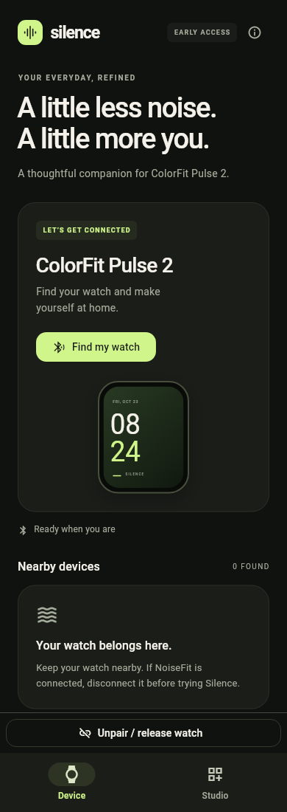
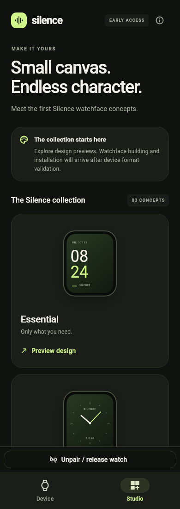

# Flutter foundation implementation

The user selected Flutter for the Android companion. The initial source lives in [app](../../app/README.md). Three subagents contributed UI, the native Android BLE bridge, and a protocol review; the parent integrated the controller, build configuration, validation and documentation.

## What was implemented

The Device screen starts disconnected, scans only on user action, lists observed nearby BLE devices and signal strength, connects/disconnects and displays discovered GATT services. It reports permission/adapter/connection/discovery failures. Android's native implementation requests the appropriate runtime permissions, applies timeouts and releases scan/GATT resources. Native and Flutter layers ignore stale connection callbacks.

Studio contains Essential, Analog and Activity design concepts and working preview dialogs. They are painted illustrations with sample values, not exported or installable watchfaces. Demo mode is explicit and displays its simulated status; entering/leaving it clears simulated device state and does not issue sample transfer commands.

Flutter owns the UI and operation controller; a small Kotlin implementation provides Android BLE through method/event channels. There is no vendor SDK dependency or backend account requirement. Fonts are bundled locally. The web target previews the same UI and clearly reports that live BLE is Android-only.

This is the **initial part of M1**, with visual previews of later milestones. Verified TouchGUI initialization/queries, hardware identity confirmation, the compiler/editor, local face import/persistence, transfers and firmware installation are not completed.

## Visual review

| Device | Studio |
| --- | --- |
|  |  |

These are actual Flutter engine renders of the implemented screens. They show the disconnected initial state and sample concept artwork, not a live device session.

## Checks and limitations

Static analysis, web compilation, native Kotlin bridge compilation and Android resource compilation were checked. The socket-free render/smoke harness exercises controller events, real layout and preview-dialog actions. See [validation status](../../app/tool/validation.json) for the recorded final results.

This sandbox denies local socket binding. Gradle cannot initialize its file-lock coordination service, so an APK has not been assembled here. Flutter's standard test runner cannot start its localhost engine communication server; its widget suite compiled but did not execute. These limits are reported separately from successful direct-engine smoke checks. No physical watch or phone operation was performed by this implementation session.

The direct-engine smoke runner does not establish real Bluetooth interoperability, power behavior, background reliability, successful vendor queries or any transfer compatibility. Normal widget tests and Android build/device checks should run in the host development environment.

## Next concrete task

Use the application to record the real device's advertised identity and GATT table, then follow the [verified protocol research boundary](04-flutter-protocol-boundary.md). Implement serialized notification setup and the verified TouchGUI query sequence before exposing live battery/firmware data. Watchface upload remains a separate milestone after that transport/session baseline is established.

## 0.1.1 urgent connection-release fix

User testing found that Silence could hold the BLE connection while the watch stayed on its QR screen. Force-stopping Silence released it and NoiseFit pairing worked again. An always-visible Unpair / release watch button now releases native BLE ownership even while connecting/discovering, clears local state and prevents late callbacks from reconnecting the UI. The recovery dialog offers Android Bluetooth settings and explains the separate NoiseFit pairing step. See the [runtime finding](04-flutter-protocol-boundary.md#user-observed-connection-ownership-and-recovery).
