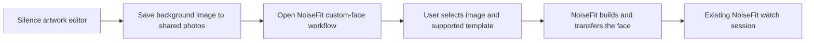

# NoiseFit-owned Bluetooth connection: wallpaper and feature handoff

> **Superseded.** The custom face editor this route depends on is paywalled, so Silence now binds and uploads to the watch itself ([07](07-touchgui-bind.md), [08](08-watch-file-transfer.md)). The handoff buttons were removed in 0.7.0. This document is kept as research history.

## Research direction

Keep NoiseFit as the owner of its watch session, binding, health synchronization and transfers. Silence should first create artwork and hand it to an existing NoiseFit workflow. This follows the user-observed recovery: stopping Silence released its connection and NoiseFit pairing worked again.

The goal is to submit an operation to NoiseFit, which already holds a usable session. A separately created Flutter `BluetoothGatt` client is not a reference to NoiseFit's TouchGUI client or its application state. Android cross-process cooperation requires an interface the receiving app implements. A typical bound-service design deliberately supplies a Binder interface for callers; see [Android's GATT service example](https://developer.android.com/develop/connectivity/bluetooth/ble/connect-gatt-server).

**Result of this static review:** a stock-app wallpaper handoff is promising. A direct, general-purpose external file/command API for stock NoiseFit was not verified. An app navigation deep link is not a watchface upload API.

Research was offline against NoiseFit **5.4.6, build 876**. No Noise backend requests, application launches, service bindings, file transfers or device writes were performed. The installed app version and actual device metadata can change runtime behavior.

## Recommended first data flow

This can preserve the current NoiseFit connection: Silence does not need to scan, connect, bind, subscribe or transfer. It can remain a creative companion rather than a second device client.

The initial handoff is **background artwork**, not an arbitrary compiled watchface. Dynamic time, date, hands and other live widgets remain controlled by NoiseFit's supported templates and the watch. Do not export the current Studio concept screenshot with its sample time and claim those painted digits will become a working clock.

## Confirmed static evidence

### A custom-face navigation target exists

The APK navigation graph declares:

| URI identifier | Destination / reviewed role |
| --- | --- |
| `https://link.gonoise.com/CustomWf` | `HandleDeepLinkCustomWatchfaceFragment` |
| `https://link.gonoise.com/WatchFaceScreen` | `HandleDeepLinkWatchfaceFragment` |
| `https://link.gonoise.com/WatchfaceNew` | `HandleDeepLinkWatchfaceFragmentNew` |

These are navigation identifiers extracted from the APK, not endpoints contacted in this investigation. The broader `https://link.gonoise.com/` host is accepted by exported `SplashActivity`.

The custom handler checks selected-device state and `WatchesSDK.q()`. The latter checks the persisted `DeviceFeatures.hasWfCategory` flag, **not connection readiness**. In the category-enabled branch, `SDK_EVOLVE` is among the SDK types routed to resource ID `0x7f0a068a`, resolved as `diyWatchFaceFragment`, with the custom type in a Bundle. In another metadata branch, the same device may not reach that editor through this handler. The actual Pulse 2 flag has not been read from the user's installed app.

Sources: [manifest deep-link filter](../../analysis/AndroidManifest.xml#L462), [decoded navigation graph](../../analysis/noisefit-handoff/navigation-app.txt#L1586), [custom route handler](../../analysis/smali/classes4/com/noisefit/ui/watchface/HandleDeepLinkCustomWatchfaceFragment.smali#L213), [feature flag getter](../../analysis/smali/classes5/com/noisefit/watch/WatchesSDK.smali#L1246), [resource ID](../../analysis/resources.txt#L17912).

A future Android launcher could construct an `ACTION_VIEW` intent for the custom URI and explicitly target `com.noisefit`. Explicitly targeting the app avoids deliberately falling back to a browser. It still needs runtime validation, package-visibility handling and a manual navigation fallback. NoiseFit may itself contact its catalog/backend after opening; this is not a claim that the whole official workflow is offline.

No custom image URI or binary-file input parameter was established for this link. Passing guessed extras such as `filePath` would not make them recognized by the app.

### The DIY workflow consumes a selected image

`DiyWatchFaceFragment.I4(...)` constructs `android.intent.action.PICK`, sets MIME type `image/*` and launches a chooser. Its result handling includes UCrop and gallery-related processing. It also dispatches `UpdateDeviceAction.SetDiyWatchFaceCustom` through its own `SessionManager`.

Sources: [gallery chooser](../../analysis/smali/classes3/com/noisefit/ui/diy/DiyWatchFaceFragment.smali#L1398), [crop processing](../../analysis/smali/classes3/com/noisefit/ui/diy/DiyWatchFaceFragment.smali#L10811), [internal custom-face dispatch](../../analysis/smali/classes3/com/noisefit/ui/diy/DiyWatchFaceFragment.smali#L596).

For the Evolve adapter, `q0(DiyCustomWatchFace)` obtains the image Bitmap and a template/bin-file path, constructs a `TGPhotoDialBuilder`, sets relevant properties, builds the dial and sends it through `TGClient.f()` / `TGDialManager.e(...)`. It therefore has an existing route from background image plus template to a device transfer inside NoiseFit.

Sources: [shared-service dispatch to q0](../../analysis/smali/classes18/com/noisefit/receiver/service/ConnectionService.smali#L2052), [Evolve photo-dial path](../../analysis/smali/classes5/com/noisefit_evolve2/handler/Evolve2UpdateDeviceUnitsHandler.smali#L3265).

This supports trying shared-photo selection before solving a complete custom watchface binary compiler. It does not establish that every template is available to this watch/account, or eliminate template downloads/catalog requirements.

## External control surfaces inspected

| Surface | Observed interface | Finding for this project |
| --- | --- | --- |
| `ConnectionService`, exported | `onBind` returns null; `onStartCommand` recognizes `START`, `STOP`, `INIT_DEFAULT` | No file/custom-face input in those reviewed entry points; exported does not mean arbitrary internal actions are accessible |
| `TvsConnectionService`, exported AIDL | `J3(IDeviceDetailsCallback)`, `U8(IUserDetailsResponseCallback)`, `S1(UserDetails)` | Narrow TVS account/device/EV-data interface; no watchface/file or generic BLE command |
| SiFli watchface service | Local Binder methods, without a reviewed remote AIDL/transaction interface | Java methods on a local Binder are not automatically a cross-process API; also another SDK family |
| NoiseFit `FileProvider` | Unexported; temporary URI grants supported | Existing provider does not constitute an incoming installation endpoint |
| App-owned exported intent filters | No `ACTION_SEND` filter found | No registered ordinary share-sheet image receiver identified; absence of a filter alone does not rule out every explicit-intent path |
| Reviewed exported receivers | Phone-finding, reminders, boot/connection and location roles | No verified watchface URI receiver |
| Internal `SessionManager` actions | Rich configuration and file-transfer actions inside NoiseFit | Useful future bridge targets, but internal methods alone are not an external API |

Sources: [ConnectionService Binder](../../analysis/smali/classes18/com/noisefit/receiver/service/ConnectionService.smali#L10857), [start actions](../../analysis/smali/classes18/com/noisefit/receiver/service/ConnectionService.smali#L11220), [TVS AIDL](../../analysis/smali/classes17/com/noisefit/ITVSNoiseConnectService.smali), [TVS implementation](../../analysis/smali/classes17/com/noisefit/TvsConnectionService$binder$1.smali#L119), [FileProvider declaration](../../analysis/AndroidManifest.xml#L829), [exported component inventory and review summary](../../analysis/noisefit-handoff/surface-summary.json).

This is a bounded review of the identified surfaces, not a proof that no usable interface exists anywhere in the APK.

## Feasibility by feature

| Desired feature | Stock NoiseFit cooperation route | Current status |
| --- | --- | --- |
| New wallpaper/background | Save artwork to shared photos; select in NoiseFit DIY editor; let NoiseFit transfer | Strong static candidate; end-to-end phone test pending |
| Open custom/watchface screen | Package-targeted navigation link, with manual fallback | Exact APK route found; actual metadata/startup behavior pending |
| New live clock/widget layout | Existing NoiseFit template/editor controls | Limited to exposed options; arbitrary new widget behavior not established |
| Upload any compiled watchface | External file/command handoff | No verified stock-app API found |
| Other watch configuration | Existing NoiseFit screens or a verified external control interface | Screen-by-screen research needed; no general command API established |
| New quick settings/music icons | Modified firmware/resources and an accepted installation path | Image handoff does not replace this firmware work |
| Custom firmware install | An appropriate local-file update interface or a modified-app integration | No verified general external file handoff established here |
| Health synchronization | Existing NoiseFit implementation | Leave ownership with NoiseFit; avoid unnecessary reimplementation |

## When a deeper bridge would be needed

For arbitrary compiled faces or new commands, an explicit integration inside NoiseFit could receive a local request and queue it through the existing SessionManager/vendor client. That would preserve one session owner and allow progress/error callbacks back to Silence. It is a **modified-app architecture**, not something stock NoiseFit has been proven to offer.

Such work needs controlled request types, user-selected file URI grants, input validation, serialized operations, connection-state checks and real completion feedback. Re-signing/replacing NoiseFit may affect installation over the official app, existing app data, login/integrations and future updates. Those implications must be resolved before selecting that route. This research did not patch/repackage NoiseFit, attach a runtime hook or access private caches.

An exported photo/document picker supplied by Silence is another candidate: NoiseFit could ask the user to select Silence artwork and receive a temporary readable content URI. Its `ACTION_PICK image/*` chooser is a lead for that design, not proof that every returned URI/provider is handled correctly. A simple shared-gallery image is the lower-complexity first experiment. Android documents cross-app file sharing using [content URIs and temporary read grants](https://developer.android.com/training/secure-file-sharing).

## Next proof and product changes

1. Keep the watch paired and connected to NoiseFit. Do not connect Silence's BLE inspector for this experiment.
2. Confirm that NoiseFit's custom-face/gallery workflow is available for the actual Pulse 2. Record the selected template and allowed image crop/style controls.
3. Create a clearly recognizable static background image, save it to shared photos, manually select it in NoiseFit, and use NoiseFit's own upload control. Check the actual watch output and continuing health synchronization. This is a proposed user-driven experiment; it was not performed here.
4. Test the package-targeted `CustomWf` navigation separately. A successful launch is evidence of navigation only, not image delivery or successful transfer.
5. If image handoff succeeds, implement **Save artwork** and **Open in NoiseFit** in Flutter. Keep live clock elements out of a background-only export and explain the remaining NoiseFit steps accurately.
6. Investigate an automatic file bridge only after deciding that shared-gallery/template limitations are insufficient.

For the next app milestone, prioritize artwork/export/handoff over adding another normal Bluetooth connection flow. The current BLE inspector can remain a development/research tool. This is a research and roadmap change; no app behavior was changed in this session.

## Implementation status (0.2.0, since removed)

The app now follows this direction: Studio exports a background PNG, **Save to Photos** stores it under `Pictures/Silence`, and **Open in NoiseFit** sends the package-targeted `CustomWf` link (falling back to the app launcher). The BLE inspector is hidden behind a developer switch. Minimum Android is now API 29 so MediaStore saving needs no storage permission. Still pending: the manual on-device proof in the steps above; nothing here has run against a real NoiseFit install.
