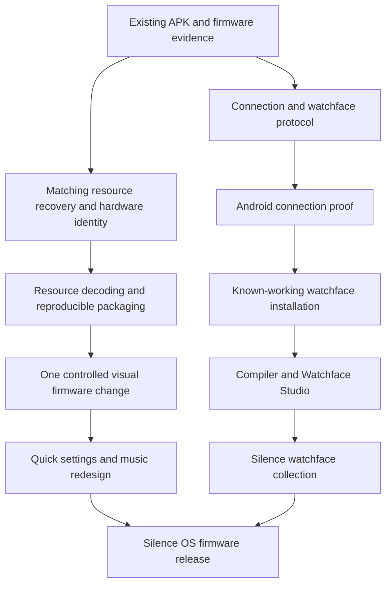

# Silence OS build plan

Silence OS is a visual redesign for the **ColorFit Pulse 2**, accompanied by an Android app for creating and installing watchfaces and, eventually, installing a modified firmware/resource distribution. The initial hardware target is the available watch running **V5.4.328.26**. Support for other models or revisions requires separate validation.

The product direction is agreed: refined icons, a coherent color palette, built-in watchfaces, improved quick settings and music controls, and a watchface library/builder. The implementation milestones below are proposals grounded in the recovered artifacts. This plan does not imply that modified firmware is already installable.

## Current research priority: NoiseFit owns the connection

The user selected [NoiseFit handoff research](06-noisefit-handoff-research.md) as the next direction. Prioritize Silence artwork export and NoiseFit’s existing custom-face upload workflow. A `CustomWf` navigation target and gallery-based Evolve photo-dial path were found; a general stock-app file/command API is not verified. Silence 0.2.0 implements the artwork export and handoff buttons. The independent connection/installer milestones below remain earlier proposals and should be re-evaluated after the on-device handoff proof.

## Current implementation

The [Flutter foundation](05-flutter-foundation.md) now provides Android BLE discovery/GATT inspection and a watchface design-preview UI. See [app setup and validation](../../app/README.md). This is the initial part of M1; device-specific queries and transfers remain pending.

## Release sequence

| Release | User-visible outcome | Required evidence before release |
| --- | --- | --- |
| **0.1 — Connection proof** | Android app identifies the watch, reads supported identity/battery/version fields, and explains connection state | Verified discovery, protocol initialization and queries on the physical Pulse 2 |
| **0.2 — Watchface installer** | Import and install a validated existing face, with progress and useful errors | A known-working face transfers and activates; recovery from failed transfer is understood |
| **0.3 — Watchface Studio** | Create a supported face from a background, time/date elements and supported widgets; save, preview and install | Compiler output is accepted by the stock firmware and matches the preview within documented font/rendering limits |
| **0.4 — Silence face collection** | Three built-in Silence designs available through the app | Each design verified on the watch, including time/date changes and NoiseFit handoff |
| **1.0 — Silence OS visual firmware** | Refined built-in artwork and redesigned quick settings/music UI | Matching resources, reproducible patch packaging, accepted update checks, demonstrated restore path and device regression results |
| **Later — Optional health companion** | Local health history and selected synchronization features in Silence | Independently validated measurement/history formats and reliable background synchronization |

The APK and watchface releases can ship even if the firmware modification path remains unresolved. We should not tie a useful watchface product to an unproven firmware release date.

## Work tracks

Design exploration can proceed alongside protocol research using the recovered 240 × 280 canvas. Device-specific limits must feed back into the design before it is committed to assets.

## Initial product boundaries

- Android first; local projects and local file import/export. An account or cloud backend is unnecessary for the first releases.
- NoiseFit remains responsible for health synchronization initially. Its continued operation must be tested, not assumed.
- Support watchfaces that can be compiled into this device's format. Importing arbitrary formats from other watch platforms is a later conversion project.
- Firmware work initially preserves the existing sensor, BLE and power-management implementation. Resource replacements precede executable layout patches where feasible.
- Keep a distinct Silence release version in project/package metadata. Preserve the watch identity and protocol values required for compatibility until their effects are understood.

## Planning documents

- [Milestones and acceptance criteria](01-roadmap.md)
- [App, watchface tools and build architecture](02-architecture.md)
- [Firmware workflow and device validation](03-firmware-and-validation.md)
- [Flutter protocol boundary](04-flutter-protocol-boundary.md)
- [Flutter foundation implementation](05-flutter-foundation.md)
- [NoiseFit-owned connection and wallpaper handoff](06-noisefit-handoff-research.md)

## Research foundation

[Model-specific Android integration](../11-colorfit-pulse-2.md), [firmware research](../firmware/README.md), [watchface format](../firmware/05-watchface-format-and-rendering.md), and [resource/OTA findings](../firmware/06-resources-and-ota.md).

The major unresolved dependencies are the direct watchface transfer protocol, complete watchface encoding/limits, matching external resource contents, exact hardware revision, and modified-image acceptance/restore behavior. These are explicit milestone outputs rather than assumptions hidden in the implementation.
